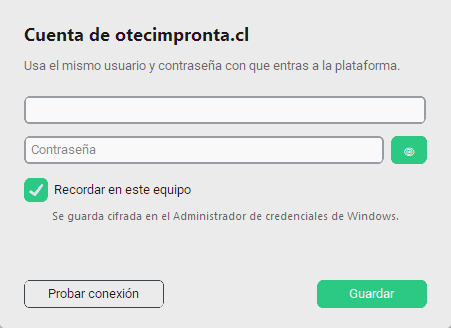
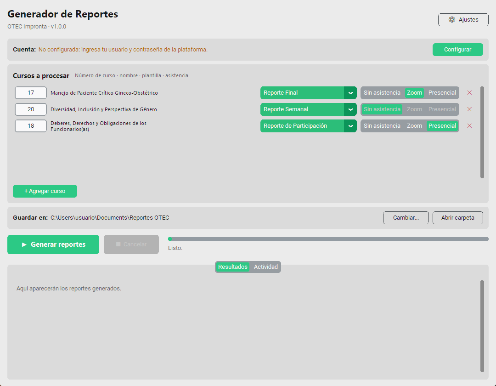
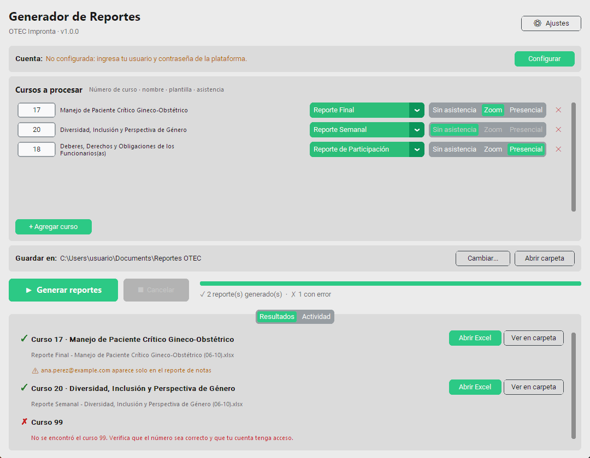
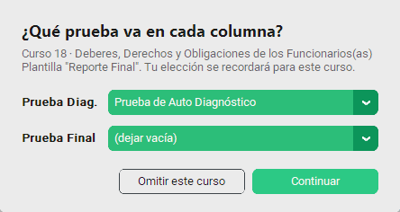
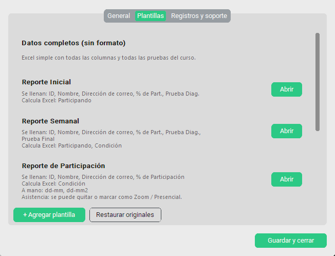

# OTEC Reportes: manual de usuario

**Versión 1.0.0**

OTEC Reportes entra a la plataforma **otecimpronta.cl** por ti y descarga la participación y las notas de los cursos que le indiques. Con eso crea los reportes en Excel usando las plantillas de siempre: colores, íconos, gráficos y resumen incluidos.

---

## 1. Qué necesitas

| Requisito | Detalle |
|---|---|
| Computador | Windows 10 u 11 |
| Microsoft Excel | Instalado en el equipo. Lo usa para llenar las plantillas. |
| Google Chrome | Instalado en el equipo. Lo usa, oculto, para entrar a la plataforma. |
| Internet | Siempre. La primera vez también descarga un componente de Chrome. |
| Cuenta | Tu usuario y contraseña de otecimpronta.cl |

---

## 2. Instalación

1. Copia el archivo **`OTEC Reportes.exe`** a una carpeta fija, por ejemplo **Documentos**. Si te llegó dentro de un `.zip`, ábrelo y arrastra el archivo fuera del zip.
2. Haz **doble clic** en `OTEC Reportes.exe`.
3. La primera vez Windows puede mostrar el aviso **"Windows protegió su PC"**. Aparece porque el programa es nuevo y no tiene firma comercial. Haz clic en **Más información** y luego en **Ejecutar de todas formas**. Solo se pide una vez.
4. Opcional: clic derecho en el archivo → **Enviar a → Escritorio (crear acceso directo)**, para abrirlo más fácil la próxima vez.

> El programa tarda unos segundos en abrir, porque se prepara cada vez que se inicia.

---

## 3. Primer uso: tu cuenta



1. En la ventana principal, junto a **Cuenta**, presiona **Configurar**.
2. Escribe tu **usuario** y **contraseña** de otecimpronta.cl. El botón 👁 muestra lo que escribiste.
3. Presiona **Probar conexión**. En unos segundos verás ✓ *Conexión correcta* o un mensaje explicando el problema.
4. Deja marcada la casilla **Recordar en este equipo** y presiona **Guardar**.

**¿Dónde queda guardada mi contraseña?** En el *Administrador de credenciales* de Windows, cifrada y asociada a tu usuario de Windows. No queda en ningún archivo. Para borrarla, abre *Cuenta → Cambiar → Olvidar la cuenta guardada*.

Si desmarcas **Recordar en este equipo**, la contraseña se usa solo mientras el programa esté abierto.

---

## 4. Generar reportes



### 4.1 Agrega los cursos

- Presiona **+ Agregar curso** y escribe el **número del curso**. Es el número que aparece al final de la dirección del curso en la plataforma, por ejemplo `...course/view.php?id=`**`17`**.
- El **nombre del curso aparece solo** a los pocos segundos. Si dice *"No se encontró el curso"*, revisa el número.
- Para quitar un curso, presiona la **✕** roja de su fila.
- La lista se guarda sola: la próxima vez que abras el programa estará igual.

### 4.2 Elige la plantilla de cada curso

| Plantilla | Para qué sirve | Qué llena |
|---|---|---|
| **Reporte Inicial** | Inicio del curso | Participación y prueba diagnóstica |
| **Reporte Semanal** | Seguimiento semanal | Participación, prueba diagnóstica y final, condición |
| **Reporte de Participación** | Solo participación | Participación, condición y asistencia |
| **Reporte Final** | Cierre del curso | Participación, asistencia, notas y condición (Aprobado, Reprobado, Pendiente, Abandono...) |
| **Datos completos (sin formato)** | Revisar todo | Excel simple con **todas** las pruebas del curso |

### 4.3 Elige la asistencia

Solo aplica a las plantillas que tienen columnas de asistencia (Participación y Final):

- **Sin asistencia:** el curso no tiene sesiones. Las columnas de asistencia **se eliminan** del reporte.
- **Zoom:** las columnas quedan con el título *Asistencia Zoom* para que las **completes a mano**.
- **Presencial:** igual que Zoom, pero con el título *Asistencia Presencial*.

> En las columnas de asistencia escribe **1** si la persona asistió y **0** si no. Puedes cambiar los títulos `dd-mm` por la fecha de cada sesión; el resumen se actualiza solo.

### 4.4 Genera

1. Revisa la carpeta en **Guardar en**. Por defecto es *Documentos\Reportes OTEC*; puedes cambiarla con **Cambiar...**.
2. Presiona **▶ Generar reportes**.
3. La barra muestra el avance. Puedes presionar **■ Cancelar** en cualquier momento: el programa termina el paso en curso y se detiene.

### 4.5 Revisa los resultados



- ✓ en verde: el reporte se creó. Usa **Abrir Excel** o **Ver en carpeta**.
- ✗ en rojo: ese curso tuvo un problema y debajo se explica qué hacer. Los demás cursos se generan igual.
- ⚠ en naranjo: avisos que conviene revisar, por ejemplo *"aparece solo en el reporte de notas"*. Significa que esa persona está en las notas pero no en la participación. Sale igual en el reporte.

Los archivos se llaman, por ejemplo, `Reporte Final - Toma Espirometría (06-10).xlsx`. Si ya existe uno con el mismo nombre, el programa **no lo borra**: crea `... (2).xlsx`.

---

## 5. Cuando el programa pregunta por las pruebas



Algunas plantillas tienen las columnas **Prueba Diag.** y **Prueba Final**. Normalmente el programa reconoce solo qué prueba de la plataforma va en cada una. Cuando un curso tiene nombres distintos o varias pruebas parecidas, te pregunta:

- Elige en cada lista la prueba que corresponde, o **(dejar vacía)**.
- Presiona **Continuar**. Tu elección **se recuerda para ese curso** y no se vuelve a preguntar.
- **Omitir este curso** salta ese curso y sigue con los demás.

---

## 6. Ajustes

Presiona **⚙ Ajustes**, arriba a la derecha.

**General**

- *Mostrar el navegador mientras trabaja:* deja ver Chrome mientras entra a la plataforma. Úsalo solo si soporte te lo pide.
- *Tiempo máximo de espera por descarga:* auméntalo si tu internet es lento (60 segundos por defecto).

**Plantillas**



- Cada plantilla muestra qué columnas **se llenan**, cuáles **calcula Excel** y cuáles van **a mano**.
- **Abrir** abre la plantilla en Excel. Si la modificas y guardas, los próximos reportes usarán tus cambios.
- **+ Agregar plantilla** suma una plantilla tuya (ver sección 7).
- **Restaurar originales** vuelve las 4 plantillas originales a como venían.

**Registros y soporte**

- **Exportar diagnóstico:** crea un archivo `.zip` para enviar a soporte cuando algo falla (sección 9).
- **Abrir carpeta de registros:** muestra los registros de cada uso del programa.

---

## 7. Crear tu propia plantilla

1. Parte de una copia de una plantilla existente (Ajustes → Plantillas → **Abrir** → *Guardar como*).
2. Revisa que cumpla estos requisitos:
    - Los datos de los alumnos deben estar en una **tabla de Excel** (*Insertar → Tabla*), con los títulos en la primera fila de la tabla.
    - Debe tener una columna **Nombre** o **Dirección de correo**.
    - Deja **al menos una fila vacía** bajo los títulos. El programa agrega las filas que falten.
3. Usa títulos de columna que el programa reconozca (tabla de abajo).
4. En el programa: **Ajustes → Plantillas → + Agregar plantilla**, elige el archivo y ponle un nombre. Ese nombre irá al inicio del nombre de cada reporte.

**Títulos de columna que el programa reconoce:**

| Título en la tabla | Se llena con |
|---|---|
| `ID`, `RUT` o `RUN` | Número de ID del alumno |
| `Nombre` | Nombre completo |
| `Dirección de correo` o `Correo` | Correo |
| Empieza con `%` y contiene *Part* o *Avance* (p. ej. `% de Part.`) | % de participación |
| `Prueba Diag.` / `Prueba Final` / otros que empiecen con *Prueba* o *Nota*, o que estén bajo un título "Notas" | Nota de la prueba (se pregunta cuál si hay dudas) |
| Columnas bajo un título que diga *Asistencia* | Asistencia (se quita o se renombra según el curso) |
| Columnas con **fórmula** en la primera fila | Las calcula Excel (no se tocan) |
| Cualquier otra | Queda vacía para llenarla a mano |

---

## 8. Problemas frecuentes

| Mensaje o problema | Qué hacer |
|---|---|
| *Usuario o contraseña incorrectos* | Cuenta → **Cambiar**, revisa los datos y usa **Probar conexión**. |
| *No hay conexión a internet o la plataforma no responde* | Revisa tu internet. Abre otecimpronta.cl en el navegador para ver si funciona. |
| *No se pudo abrir Google Chrome* | Instala Chrome desde google.com/chrome. La primera vez se necesita internet. |
| *No se encontró el curso X* | Revisa el número del curso y que tu cuenta tenga acceso a él. |
| *La plataforma tardó demasiado* | Intenta de nuevo. Si se repite, aumenta el tiempo de espera en Ajustes. |
| *No se pudo generar el Excel* | Verifica que Excel esté instalado y **cierra** el reporte si lo tienes abierto. |
| *El curso no tiene participantes inscritos* | El curso aún no tiene alumnos en la plataforma. |
| *El programa ya está abierto* | Ya hay una ventana abierta: búscala en la barra de tareas. |
| Windows dice "Windows protegió su PC" | **Más información → Ejecutar de todas formas** (sección 2). |
| Mi Excel abierto se cerró | No debería pasar: el programa usa su propio Excel oculto y nunca cierra el tuyo. Si ocurre, envía un diagnóstico. |

---

## 9. Pedir ayuda a soporte

1. **⚙ Ajustes → Registros y soporte → Exportar diagnóstico.**
2. Elige dónde guardarlo (por ejemplo, el Escritorio).
3. Envía el archivo `Diagnostico OTEC ....zip` a soporte, explicando qué estabas haciendo.

El diagnóstico incluye los últimos registros y capturas de pantalla de la plataforma cuando hubo errores. **Nunca incluye tu contraseña.** Las capturas pueden mostrar nombres de alumnos, así que envíalo solo a soporte.

**Prueba de instalación (para soporte).** En una ventana de comandos, ejecuta:

```
"OTEC Reportes.exe" --self-test C:\autoprueba
```

Revisa que Excel, las plantillas, el Administrador de credenciales y Chrome funcionen en ese equipo, sin entrar a la plataforma. El resultado queda en `C:\autoprueba\selftest.txt`.

---

## 10. Dónde guarda las cosas el programa

| Qué | Dónde |
|---|---|
| Reportes generados | La carpeta elegida en **Guardar en** (por defecto *Documentos\Reportes OTEC*) |
| Contraseña | Administrador de credenciales de Windows (entrada `OTECImpronta`) |
| Lista de cursos, ajustes, pruebas elegidas | `%LOCALAPPDATA%\OTECImpronta\settings.json` |
| Plantillas en uso | `%LOCALAPPDATA%\OTECImpronta\plantillas` |
| Registros (últimos 30 usos) | `%LOCALAPPDATA%\OTECImpronta\logs` |
| Archivos descargados con error (para diagnóstico) | `%LOCALAPPDATA%\OTECImpronta\descargas` |

> Para desinstalar: borra `OTEC Reportes.exe`, la carpeta `%LOCALAPPDATA%\OTECImpronta` y, si quieres, la entrada `OTECImpronta` del Administrador de credenciales.
